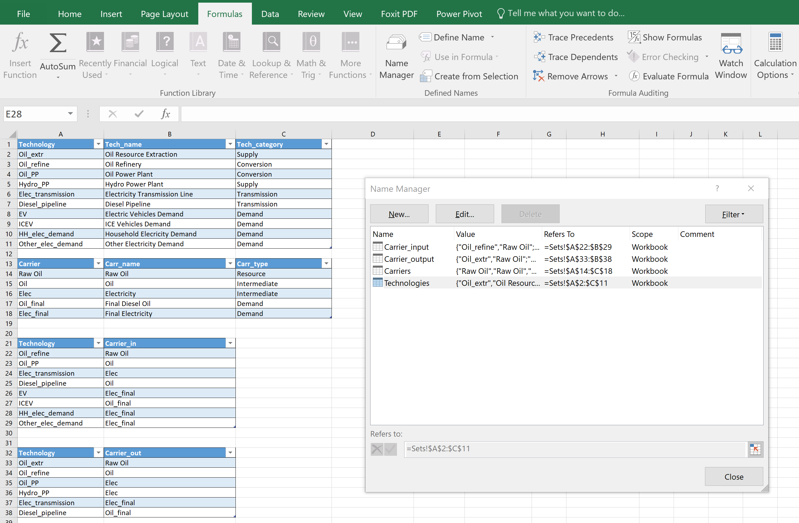
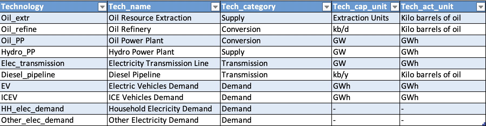

.. _building-a-model:

Building a model
================

A model is a folder of Excel files in two groups. The *set files* say what
the energy system contains: regions, years, time steps, technologies,
carriers and how they connect. The *parameter files* hold the numbers:
costs, efficiencies, demand profiles, limits. Hypatia writes the parameter
files itself, as templates, from the set files, so building a model always
goes in this order:

#. write the set files;
#. create a :class:`~hypatia.Model` from them;
#. let Hypatia write the parameter templates;
#. fill the templates with the data;
#. read the data and run.

A typical folder looks like this:

.. code-block:: text

   my_model/
   |-- sets/
   |   |-- global.xlsx
   |   |-- reg1.xlsx                    # one file per region
   |   `-- reg2.xlsx
   |-- parameters/
   |   |-- parameters_reg1.xlsx         # one file per region
   |   |-- parameters_reg2.xlsx
   |   |-- parameters_global.xlsx       # only with several regions
   |   `-- parameters_connections.xlsx  # only with several regions
   `-- results/

The easiest start is to copy an example that resembles the system you want
to model (:func:`~hypatia.download_example`) and change it.

Set files
---------

Each set file has a worksheet named ``Sets`` holding a few *Excel tables*
(Insert > Table in Excel). Hypatia finds the tables by their name, not by
their position, so the name of each table must be exactly the one below; in
Excel it is set in Formulas > Name Manager, or in the Table Design tab.

   The ``Sets`` sheet of a regional set file and its four tables in the
   Name Manager.

The column headers must also be exactly as listed, in the same order, and no
cell may be empty. Names of regions, technologies and carriers are
identifiers: they are case sensitive, and the same name must be spelled the
same way in every file.

``global.xlsx``
~~~~~~~~~~~~~~~

.. list-table::
   :widths: 18 40 42
   :header-rows: 1

   * - Table
     - Columns
     - Content
   * - ``Regions``
     - ``Region``, ``Region_name``
     - One row per region. ``Region`` is the code used in file names
       (``reg1`` requires ``sets/reg1.xlsx`` and
       ``parameters_reg1.xlsx``); ``Region_name`` is a label for plots.
   * - ``Years``
     - ``Year``, ``Year_name``
     - One row per modelled year. ``Year`` is a code used in the parameter
       files (``Y0``, ``Y1``, ...), ``Year_name`` the calendar year shown in
       the results. Operation models have exactly one year (Hypatia stops
       otherwise). The years must be consecutive: lifetimes and discounting
       count rows, not calendar years (see :ref:`review-notes`).
   * - ``Timesteps``
     - ``Timeslice``, ``Timeslice_name``, ``Timeslice_fraction``
     - One row per time step of a year, with the fraction of the year it
       represents (1/8760 for hours). The fractions should add up to one;
       Hypatia warns if they do not. Without this table each year is one
       time step.
   * - ``Carriers_glob``
     - ``Carrier``, ``Carr_name``, ``Carr_type``, ``Carr_unit``
     - Every carrier of the model. ``Carr_type`` is ``Resource``,
       ``Intermediate`` or ``Demand``; ``Carr_unit`` is a label for plots and
       results, never used in calculations.
   * - ``Technologies_glob``
     - ``Technology``, ``Tech_name``, ``Tech_category``, ``Tech_cap_unit``,
       ``Tech_act_unit``
     - Every technology of the model. ``Tech_category`` is one of
       ``Supply``, ``Conversion``, ``Conversion_plus``, ``Transmission``,
       ``Storage``, ``Demand``. The two units (capacity and activity) are
       labels, as for carriers.
   * - ``Emissions``
     - ``Emission``, ``Emission_name``, ``Emission_unit``
     - Emission types (CO2, CH4, ...). At least one row is needed.

   A ``Technologies_glob`` table. The units are labels: Hypatia never
   converts between them.

``<region>.xlsx``
~~~~~~~~~~~~~~~~~

.. list-table::
   :widths: 18 40 42
   :header-rows: 1

   * - Table
     - Columns
     - Content
   * - ``Technologies``
     - ``Technology``, ``Tech_name``, ``Tech_category``
     - The technologies present in this region, taken from
       ``Technologies_glob``. Every region needs at least one ``Demand``
       technology.
   * - ``Carriers``
     - ``Carrier``, ``Carr_name``, ``Carr_type``
     - The carriers used in this region, taken from ``Carriers_glob``.
   * - ``Carrier_input``
     - ``Technology``, ``Carrier_in``
     - Which carrier each technology consumes, one row per pair. Supply
       technologies do not appear here. A Conversion_plus technology has one
       row per input carrier.
   * - ``Carrier_output``
     - ``Technology``, ``Carrier_out``
     - Which carrier each technology produces. Demand technologies do not
       appear here.

When the model is created, Hypatia checks the set files and stops with a
message naming the file and table if a table name or column is wrong, a cell
is empty, a category or carrier type is not one of the allowed values, a
mapping refers to a technology or carrier not declared in the region, a
supply (demand) technology appears among the inputs (outputs), a region has
no demand technology, or an Operation model has more than one year.

Creating the model and the templates
------------------------------------

.. code-block:: python

   from hypatia import Model

   model = Model(
       path="my_model/sets",
       mode="Planning",              # or "Operation"
       optimization="Single",        # or "MinEm", "Multi"
       ensure_feasibility="No",      # "Yes" allows unmet demand at a penalty
       optional_constraints=[],      # e.g. ["chp_operating_range"]
   )
   model.create_data_excels("my_model/parameters")

``create_data_excels`` writes one file per region and, with several regions,
``parameters_global.xlsx`` and ``parameters_connections.xlsx``. Every sheet
is already shaped for the model, with one row per year (and time step, where
the parameter varies within the year) and one column per technology, carrier
or line, and filled with a default value. It refuses to overwrite an existing
folder unless ``force_rewrite=True`` is given, so filled data is not lost by
accident.

.. important::

   The sheets depend on the mode, on the number of regions, on the
   technology categories present and on the optional constraints. Choose all
   of them before creating the templates, and create the templates again
   after changing any of them: a model with ``production_ramp`` reads the
   ramp sheets, and stops if they are missing.

Filling the parameter files
---------------------------

Every sheet, its unit, its default and its meaning are listed in
:ref:`input-reference`. A few rules apply to all of them:

* change only the numbers. The first rows and columns hold the indices
  (years, time steps, technologies, carriers), sometimes on two or three
  levels; renaming, moving or deleting them, or adding notes beside a table,
  makes the file unreadable. Hypatia checks the indices and stops if they
  differ from the template;
* no cell may be empty: an empty cell is read as "not a number" and
  rejected. Write 0 where a value is zero;
* formulas are allowed (the examples use them), because Hypatia reads the
  values Excel computed and saved with the file. A file written by a Python
  library such as openpyxl has formulas without computed values, and Hypatia
  then finds empty cells. When editing parameter files from Python, write
  numbers, or open and save the file in Excel afterwards;
* the defaults are placeholders (no cost, efficiency 1, limits of
  :math:`10^{10}` or more), not data. Two of them are traps: the investment
  cost defaults to 0, so a technology left at its defaults is free to build,
  and the technical lifetime defaults to 1 year, so capacity built in one
  year is gone the next;
* units are free but must be consistent. The energy produced in a time step
  is capacity × resource capacity factor × time-step fraction ×
  ``AnnualProd_perunit_capacity``; with capacity in MW and energy in MWh,
  ``AnnualProd_perunit_capacity`` is 8760 (MWh per MW per year). Demand must
  be in the activity unit of the technologies that serve it. See
  :ref:`nomenclature` for the dimension of every parameter.

With one region all parameters are in the regional file. With several
regions, parameters that concern the whole system (global emission caps,
global capacity and production limits, the discount rate, the list of
renewable technologies, and some options' settings) move to
``parameters_global.xlsx``, and the lines between regions are described in
``parameters_connections.xlsx``. Lines are named after their two regions in
alphabetical order (``reg1-reg2``, never ``reg2-reg1``) and carry every
carrier; a line that should not exist, or a carrier that should not travel
on it, gets a zero residual capacity and a zero maximum capacity.

Reading the data
----------------

.. code-block:: python

   model.read_input_data("my_model/parameters")

The folder may be different from the one the templates were written to.
Hypatia reads every sheet the model needs and checks indices and empty
cells. It does not check that values are in a sensible range (a negative
efficiency or a share above 1 is accepted), so it is worth plotting the main
inputs before a long run.

The model is then ready to run: see :ref:`results`.
